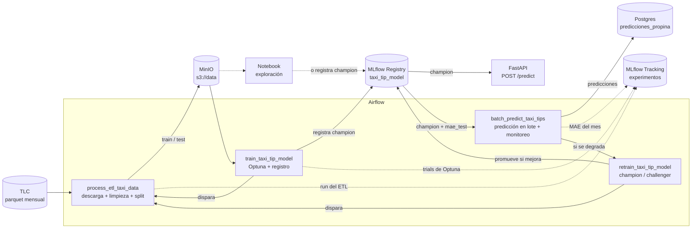

# Propinas de taxis de NYC en producción
### MLOps1 - CEIA - FIUBA

TP final de Operaciones de Aprendizaje de Máquina I. Llevamos al ambiente productivo de **ML Models and something more Inc.** el modelo que armamos en Aprendizaje de Máquina I: una regresión que estima la propina (`tip_amount`) de viajes de Yellow Taxi pagados con tarjeta.

## Integrantes

- Lorenzo Fioranelli, Rocío Macarena - a2643
- Lerner, Federico Ezequiel - a2619
- Makk, Azul de los Angeles - a2622
- Moguilner Reh, Nicolás Francisco - a2623

## Resumen

- Repo de AMq1: https://github.com/fedlerner/CEIA-AdM-TP-Yellow_Taxi_NYC
- Datos: [TLC Trip Record Data](https://www.nyc.gov/site/tlc/about/tlc-trip-record-data.page), un archivo parquet por mes.
- Modelo: `HistGradientBoostingRegressor` con pérdida absoluta, ajustado con Optuna.
- Nivel elegido: en contenedores (Airflow, MLflow, PostgreSQL, MinIO y FastAPI en Docker).

## Flujo



1. **ETL (DAG `process_etl_taxi_data`):** baja el mes elegido de la TLC a `s3://data/raw/` (si no estaba), lo limpia con las mismas reglas de AMq1, se queda con las 11 features del modelo, toma una muestra y guarda `clean.parquet`, `train.parquet`, `test.parquet` y `data_info.json` en `s3://data/taxi/<mes>/`. Registra el run en el experimento `Taxi Tip ETL`.
2. **Entrenamiento (DAG `train_taxi_tip_model`):** dispara el ETL del mes y espera a que termine. Después busca hiperparámetros con Optuna (15 trials, CV de 3 folds sobre train), cada trial como run anidado del experimento `Taxi Tip`. El mejor pipeline se reentrena con todo el train, se compara contra dos baselines, se evalúa en test y se registra como `taxi_tip_model`. Si no había champion, o si mejora el MAE del champion actual en al menos 1 % en este mismo test, pasa a `champion` (y el anterior queda como `old_champion`); si no, queda como `challenger`. Con este DAG, un solo trigger lleva de no tener datos a tener la API sirviendo un modelo.

   La notebook `notebooks/experimento_mlflow.ipynb` hace lo mismo a mano y suma gráficos (predicción vs. real, importancia por permutación) y una prueba de carga. La búsqueda, los baselines y la regla de promoción están en `src/taxi_tip/training.py`, compartido por el DAG y la notebook.
3. **API (FastAPI):** carga `taxi_tip_model@champion` desde MLflow y estima la propina de un viaje (`POST /predict`) o de hasta 1000 (`POST /predict/batch`). Valida las entradas con Pydantic. `GET /health` responde 503 mientras no haya un modelo cargado. Cada 60 segundos se fija en segundo plano si hay un champion nuevo y, si lo hay, lo carga, aunque no lleguen requests. No hace falta reiniciar el contenedor.
4. **Predicción en lote (DAG `batch_predict_taxi_tips`):** toma un mes nuevo, lo limpia igual que el ETL, predice todos sus viajes con el `champion` y los carga en la tabla `predicciones_propina` de la base `taxi` (si el mes ya estaba, lo reemplaza). Como en los datos viene la propina real, registra MAE, RMSE y R² del mes en el experimento `Taxi Tip Monitoreo`, con un run por mes. Si el MAE del mes es más de 1,2 veces el MAE de test del champion (variable `taxi_mae_alert_ratio`), marca el run con `alerta=degradacion` y dispara el reentrenamiento con ese mes.
5. **Reentrenamiento (DAG `retrain_taxi_tip_model`):** dispara el ETL del mes y espera a que termine, clona el pipeline del `champion` (mismos hiperparámetros), lo entrena con el train nuevo y lo registra como `challenger`. Después evalúa los dos con el test del mes nuevo: si el challenger baja el MAE al menos un 1 % (variable `taxi_min_improvement`) pasa a `champion` y el anterior queda como `old_champion`, por si hay que volver atrás; si no, se descarta. La API se entera sola del cambio.

## Algunas decisiones

El ETL solo limpia y elige columnas. Todo el feature engineering (winsorización, variables cíclicas, aeropuerto, hora pico, target encoding de zonas, dummies) está dentro de un `Pipeline` de sklearn (`src/taxi_tip/features.py`), y lo que registramos en MLflow es ese pipeline entero. Así la API y el DAG de lote le pasan al modelo las mismas 11 columnas que usamos para entrenar, y no tuvimos que reescribir el preprocesamiento en cada lado.

Como el pipeline tiene un transformer nuestro (`TaxiFeatureEngineer`), lo logueamos con `code_paths`: MLflow guarda el paquete `taxi_tip` junto con el modelo y la API no necesita tenerlo instalado. Airflow sí lo usa para entrenar, así que `src/` se monta en sus contenedores (solo lectura) y se agrega al `PYTHONPATH`. Además, MLflow 3 serializa con skops, que solo carga tipos marcados como confiables, así que hay que pasárselos en `skops_trusted_types`.

La descarga y la limpieza están en `airflow/dags/taxi_common/data.py` y las usan tanto el ETL como la predicción en lote. Sacamos `total_amount` porque ya incluye la propina (en AMq1 vimos que era fuga de información).

El MAE que guardamos en el tag `mae_test` de cada versión lo calculamos contra la propina real, sin el recorte al p99,5 que usamos para entrenar, y con la predicción tal cual sale del modelo. Lo hicimos así porque la predicción en lote mide de la misma forma (a Postgres va la predicción redondeada, pero el MAE se calcula con la cruda); si no, la alerta compararía dos MAE calculados de forma distinta.

Para promover un modelo nuevo exigimos que baje el MAE del champion al menos un 1 %, tanto al entrenar (DAG o notebook) como al reentrenar. Se compara sobre un único test de 60.000 viajes, y sin ese margen una diferencia de milésimas, que puede ser ruido, alcanzaría para cambiar el champion.

El reentrenamiento usa solo el mes nuevo y los mismos hiperparámetros del champion. Lo pensamos para adaptar el modelo a los datos recientes cuando el monitoreo detecta una degradación, no para rediseñarlo; para volver a buscar hiperparámetros está `train_taxi_tip_model`. Una alternativa sería entrenar con una ventana de varios meses, a costa de más datos y más tiempo de entrenamiento.

Si se corre dos veces el ETL o la predicción en lote del mismo mes, el resultado es el mismo: si el parquet crudo ya está en MinIO no se vuelve a bajar, el split tiene semilla fija, en Postgres primero se borra el mes y después se carga, y el run de monitoreo del mes reemplaza al anterior. Cada mes del ETL tiene su propia carpeta en S3, así un ETL de otro mes no le pisa los datos a un reentrenamiento que está corriendo.

Fijamos las versiones de todo lo que toca al modelo (scikit-learn 1.4.2, que es la de AMq1, numpy, pandas, skops y MLflow 3.16.1, igual que el servidor) en la imagen de Airflow, en la de FastAPI y en el entorno de la notebook, para que el modelo se cargue igual en todos lados.

## Qué queda registrado en MLflow

En http://localhost:5001:

| Experimento | Qué tiene |
|---|---|
| `Taxi Tip ETL` | Un run por ETL: mes, filas de train y test, y la descripción del dataset |
| `Taxi Tip` | Un run padre por entrenamiento (DAG, notebook o reentrenamiento) con un run hijo por trial de Optuna |
| `Taxi Tip Monitoreo` | Un run por mes predicho en lote: MAE, RMSE y R² contra la propina real, y si hubo alerta de degradación |

En cada run de entrenamiento (experimento `Taxi Tip`):

- **Métricas finales**: MAE, RMSE y R² en test (con el target recortado y sin recortar) y los de los dos baselines.
- **Curvas** (pestaña *Model metrics*): `curva_mae_train` y `curva_mae_validacion`, el MAE en cada iteración del HistGB sobre train y sobre el 10 % del train que separa para validar; y `optuna_cv_mae` / `optuna_mejor_cv_mae`, el MAE de CV de cada trial y el mejor hasta ese momento.
- **Gráficos** (pestaña *Artifacts*, carpeta `graficos/`): curva de entrenamiento, predicción vs. real, distribución de los residuos e importancia por permutación de las 11 columnas de entrada.
- **Modelo**: el pipeline completo, registrado como versión de `taxi_tip_model` con sus hiperparámetros y el `mae_test` como tags.

## Resultados

Entrenado con marzo de 2026 (muestra de 300.000 viajes, 240.000 para train y 60.000 para test). Métricas en test, en USD:

| Modelo | MAE | RMSE | R² |
|---|---|---|---|
| Baseline: mediana | 2,32 | 3,88 | -0,06 |
| Baseline: 20% del monto | 1,11 | 2,54 | 0,55 |
| HistGB afinado | 1,02 | 2,21 | 0,66 |

Contra la propina real sin recortar, el MAE de test da 1,0511. Con abril de 2026 (2.571.605 viajes que el modelo no vio) la predicción en lote dio un MAE de 1,0505, prácticamente igual, así que el monitoreo no levantó alerta. Aun así corrimos el reentrenamiento con abril para probarlo: el challenger no le ganó al champion, y el champion se mantuvo.

En AMq1 el mismo pipeline dio un MAE de 1,0073 en test (1,0436 sin recortar). Los números no son directamente comparables: en AMq1 entrenamos con el mes completo (2.036.220 viajes de train y 509.055 de test) y acá con una muestra de 300.000 (variable `taxi_sample_size`), para que el ETL y la búsqueda de hiperparámetros tarden minutos. Una diferencia de alrededor de un centavo de MAE es esperable con 8 veces menos datos y otro test. Además, acá el baseline constante es la mediana (el óptimo para MAE) y no la media, y el target encoding de zonas es el `TargetEncoder` de sklearn en lugar de la media por zona.

## Estructura

```
airflow/dags/etl_process.py           DAG de ETL
airflow/dags/train_model.py           DAG de entrenamiento (Optuna + registro del champion)
airflow/dags/batch_predict.py         DAG de predicción en lote y monitoreo
airflow/dags/retrain_model.py         DAG de reentrenamiento champion/challenger
airflow/dags/taxi_common/data.py      Descarga y limpieza de la TLC, compartida por los DAGs
airflow/dags/taxi_common/registry.py  Consultas al registro de MLflow que usan los DAGs
airflow/secrets/                      Variables y conexiones de Airflow
src/taxi_tip/features.py              Pipeline del modelo (feature engineering + HistGB)
src/taxi_tip/training.py              Baselines, búsqueda con Optuna y promoción del champion
src/taxi_tip/mlflow_utils.py          Logueo y registro del pipeline en MLflow
notebooks/experimento_mlflow.ipynb    Exploración: entrenamiento a mano, gráficos y prueba de carga
dockerfiles/fastapi/app.py            API REST
dockerfiles/                          Imágenes de Airflow, MLflow, Postgres y FastAPI
pyproject.toml / uv.lock              Entorno local para la notebook
```

## Servicios

| Servicio | URL | Usuario / clave |
|---|---|---|
| Airflow | http://localhost:8080 | airflow / airflow |
| MLflow | http://localhost:5001 | - |
| MinIO | http://localhost:9001 | minio / minio123 |
| API (FastAPI) | http://localhost:8800 (docs en `/docs`) | - |
| Postgres | localhost:5432 | airflow / airflow |

Buckets: `s3://data` (nuestros datos) y `s3://mlflow` (artefactos de MLflow).
Bases en Postgres: `airflow`, `mlflow_db` y `taxi` (predicciones).

## Cómo levantarlo

Se necesita Docker con al menos 6 GB de RAM y unos 15 GB libres de disco (las imágenes ocupan unos 5 GB, más el caché de build y los datos), y [uv](https://docs.astral.sh/uv/) para la notebook.

1. En Linux, poner en `AIRFLOW_UID` (archivo `.env`) el resultado de `id -u`, para que los archivos que Airflow escribe en `airflow/` queden a nombre del usuario. En Windows y macOS se puede dejar el valor por defecto (50000).
2. Levantar todo:
   ```bash
   docker compose --profile all up --build -d
   ```
3. Revisar con `docker ps -a` que los servicios estén *healthy*.

La base `taxi` se crea solo la primera vez que arranca Postgres. Si antes se levantó el repo de la cátedra en la misma máquina, hay que borrar el volumen una vez con `docker compose --profile all down --volumes`.

Para apagar: `docker compose --profile all down`. Para borrar todo (imágenes, buckets y bases): `docker compose --profile all down --rmi all --volumes`.

## Cómo correr el flujo completo

Los DAGs arrancan pausados: hay que activar los cuatro en la UI de Airflow (o con `airflow dags unpause <dag_id>`). El entrenamiento y el reentrenamiento disparan el ETL y lo esperan, así que si el ETL está pausado se quedan esperando hasta el timeout. Para elegir el mes, usar **Trigger DAG w/ config** con `{"month": "YYYY-MM"}`.

Para tener la API sirviendo un modelo alcanza con disparar a mano `train_taxi_tip_model`; los demás tienen otros roles:

| DAG | ¿Se dispara a mano? | Para qué |
|---|---|---|
| `train_taxi_tip_model` | Sí, primero | Entrena el modelo inicial y lo deja como `champion` |
| `process_etl_taxi_data` | No: lo disparan el entrenamiento y el reentrenamiento | Prepara los datos de un mes |
| `batch_predict_taxi_tips` | Sí, para predecir un mes nuevo | Predicción en lote, carga en Postgres y monitoreo del MAE |
| `retrain_taxi_tip_model` | Opcional: lo dispara la predicción en lote si detecta degradación | Reentrena con datos nuevos y promueve si mejora |

1. **ETL + entrenamiento**: disparar `train_taxi_tip_model` (por defecto, `2026-03`). Corre el ETL (la primera vez baja el mes de la TLC), la búsqueda de hiperparámetros y el registro. Al terminar, `taxi_tip_model` tiene su `champion` en MLflow.
2. **Notebook (opcional)**: para ver los gráficos o explorar, la notebook hace el mismo entrenamiento a mano. Usa el ETL del mes de `ETL_MONTH` (por defecto, `2026-03`), que ya corrió en el paso 1:
   ```bash
   uv sync
   uv run jupyter lab notebooks/experimento_mlflow.ipynb
   ```
   Si ya hay un champion, la versión de la notebook solo lo reemplaza si lo mejora al menos 1 %.
3. **API**: ya está levantada; hasta que termina el paso 1 responde 503, y después tarda hasta un minuto en tomar el champion (`GET /health` pasa a 200 cuando lo tomó). Se puede probar desde http://localhost:8800/docs o con el `curl` de abajo.
4. **Predicción en lote**: disparar `batch_predict_taxi_tips` (por defecto, `2026-04`). Las predicciones quedan en Postgres:
   ```bash
   docker exec postgres psql -U airflow -d taxi -c "SELECT month, count(*), avg(tip_amount), avg(tip_amount_pred) FROM predicciones_propina GROUP BY month;"
   ```
5. **Reentrenamiento**: disparar `retrain_taxi_tip_model` con un mes nuevo, o dejar que lo dispare el paso 4 cuando detecta degradación.

## Uso de la API

```bash
curl -X POST http://localhost:8800/predict -H 'Content-Type: application/json' -d '{
  "features": {
    "trip_distance": 3.2, "duration_min": 15, "fare_amount": 18.4, "recargos": 5.75,
    "PULocationID": 161, "DOLocationID": 236, "passenger_count": 1,
    "hour": 18, "dow": 2, "RatecodeID": 1, "VendorID": 2
  }
}'
# {"tip_amount": 4.81, "model_version": 1}
```

| Campo | Descripción |
|---|---|
| `trip_distance` | Distancia en millas, (0, 100] |
| `duration_min` | Duración en minutos, (0, 180] |
| `fare_amount` | Tarifa del taxímetro en USD, entre 2,50 y 1000 |
| `recargos` | Todo lo que se paga además de la tarifa (extras, impuestos, peajes, congestión, aeropuerto, CBD), en USD, entre 0 y 500 |
| `PULocationID` / `DOLocationID` | Zonas TLC de origen y destino, 1 a 265 |
| `passenger_count` | Pasajeros declarados, 0 a 9 |
| `hour` / `dow` | Hora (0 a 23) y día de la semana (0 = lunes) del inicio |
| `RatecodeID` | 1 estándar, 2 JFK, 3 Newark, 4 Nassau/Westchester, 5 negociada, 6 grupal, 99 desconocida |
| `VendorID` | 1 CMT, 2 Curb, 6 Myle, 7 Helix |

Los rangos de distancia, duración y tarifa mínima, el tope de 100 mph de velocidad media y el mínimo de USD 2,50 por milla con tarifa estándar son los mismos filtros que aplica el ETL. Los demás topes son controles para cortar datos mal cargados.

`GET /` devuelve qué versión del modelo está sirviendo, `GET /health` responde 503 si todavía no hay modelo cargado (sirve como chequeo de que la API está lista para predecir) y `POST /predict/batch` recibe `{"trips": [...]}` con hasta 1000 viajes. Si un campo está fuera de rango o el viaje no pasa esos filtros, responde 422; si todavía no hay un champion registrado, 503.

## Configuración

- Variables de Airflow en `airflow/secrets/variables.yaml`: `taxi_sample_size` (filas de la muestra de entrenamiento), `taxi_test_size`, `taxi_random_state`, `taxi_n_trials` (trials de Optuna del DAG de entrenamiento), `taxi_mae_alert_ratio` (umbral de la alerta de degradación) y `taxi_min_improvement` (mejora mínima del MAE para promover un modelo nuevo a champion).
- Conexión `taxi_db` en `airflow/secrets/connections.yaml`, usada por el DAG de predicción en lote.
- Para usar MinIO y MLflow desde scripts en la máquina local (la notebook usa estos mismos valores por defecto, y si están definidos en el entorno los respeta):
  ```bash
  export AWS_ACCESS_KEY_ID=minio
  export AWS_SECRET_ACCESS_KEY=minio123
  export AWS_ENDPOINT_URL_S3=http://localhost:9000
  export MLFLOW_S3_ENDPOINT_URL=http://localhost:9000
  export MLFLOW_TRACKING_URI=http://localhost:5001
  ```
  Dentro de los contenedores las direcciones son `http://mlflow:5000` y `http://s3:9000`.

### Cambios al ambiente base

Sobre el repo de la cátedra ajustamos:

- `LOAD_EXAMPLES=false`, para que en la UI de Airflow solo aparezcan nuestros DAGs.
- Base `taxi` en Postgres (`dockerfiles/postgres/mlflow.sql`) y conexión `taxi_db`.
- MLflow usa `postgresql+psycopg://` en el backend store. Con el driver implícito, SQLAlchemy < 2.1 busca psycopg2, que la imagen ya no trae, y el servidor no arrancaba.
- La imagen de Airflow deja `/tmp/.cache` escribible para el grupo 0. Si no, con un `AIRFLOW_UID` distinto de 50000 (el caso de Linux) las tareas `@task.virtualenv` no pueden crear su entorno.
- La imagen de Airflow agrega scikit-learn, skops, awswrangler y Optuna, y fija MLflow, numpy, pandas y pyarrow; la de FastAPI suma MLflow, scikit-learn y skops con las mismas versiones.
- Airflow recibe `MLFLOW_TRACKING_URI` por variable de entorno, así los DAGs no repiten la dirección del servidor.
- `src/` se monta en los contenedores de Airflow y se agrega al `PYTHONPATH`, para que los DAGs usen el paquete `taxi_tip`.
- El contenedor que crea los buckets espera a que MinIO responda en lugar de dormir 5 segundos fijos. Antes, si MinIO tardaba en arrancar, los buckets no se creaban y el contenedor terminaba igual sin error.
- La API corta los reintentos del cliente de MLflow (`MLFLOW_HTTP_REQUEST_MAX_RETRIES=1`), para no quedarse colgada si MLflow se cae.
- La API depende de MLflow y MinIO, y ya no de Airflow, que no usa. Su healthcheck usa `curl --fail`, que sí falla si el servidor responde con error.
- La imagen de FastAPI instala las dependencias antes de copiar `app.py`, así un cambio en la API no reinstala todo, y fija `fastapi` y `uvicorn` en las versiones de `uv.lock`.
