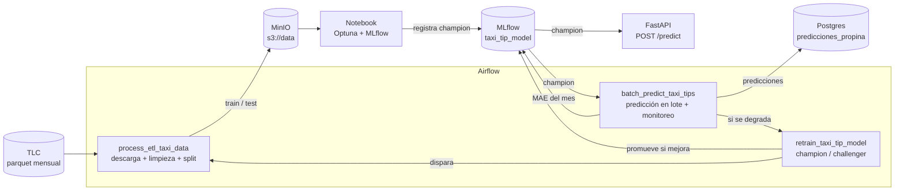

# Propinas de taxis de NYC en producción
### MLOps1 - CEIA - FIUBA

TP final de Operaciones de Aprendizaje Automático I. Llevamos al ambiente productivo de **ML Models and something more Inc.** el modelo que armamos en Aprendizaje de Máquina I: una regresión que estima la propina (`tip_amount`) de viajes de Yellow Taxi pagados con tarjeta.

## Integrantes

- Lorenzo Fioranelli, Rocío Macarena - a2643
- Lerner, Federico Ezequiel - a2619
- Makk, Azul de los Angeles - a2622
- Moguilner Reh, Nicolás Francisco - a2623

## Resumen

- Repo de AMq1: https://github.com/fedlerner/CEIA-AdM-TP-Yellow_Taxi_NYC
- Datos: [TLC Trip Record Data](https://www.nyc.gov/site/tlc/about/tlc-trip-record-data.page), un archivo parquet por mes.
- Modelo: `HistGradientBoostingRegressor` con pérdida absoluta, ajustado con Optuna.
- Nivel elegido: en contenedores (Airflow, MLflow, PostgreSQL, MinIO y FastAPI en Docker).

## Flujo



1. **ETL (DAG `process_etl_taxi_data`):** baja el mes elegido de la TLC a `s3://data/raw/` (si no estaba), lo limpia con las mismas reglas de AMq1, se queda con las 11 features del modelo, toma una muestra y guarda `train.parquet`, `test.parquet` y `data_info.json` en `s3://data/taxi/<mes>/`. Registra el run en el experimento `Taxi Tip ETL`.
2. **Experimento (`notebooks/experimento_mlflow.ipynb`):** búsqueda de hiperparámetros con Optuna (15 trials, CV de 3 folds sobre train), cada trial como run anidado del experimento `Taxi Tip`. El mejor pipeline se reentrena con todo el train, se compara contra dos baselines, se evalúa en test y se registra como `taxi_tip_model`. Si no había champion, o si le gana al champion actual en este mismo test, pasa a `champion`; si no, queda como `challenger`.
3. **API (FastAPI):** carga `taxi_tip_model@champion` desde MLflow y estima la propina de un viaje (`POST /predict`) o de hasta 1000 (`POST /predict/batch`). Valida las entradas con Pydantic. Cada 60 segundos se fija en segundo plano si hay un champion nuevo y, si lo hay, lo carga, aunque no lleguen requests. No hace falta reiniciar el contenedor.
4. **Predicción en lote (DAG `batch_predict_taxi_tips`):** toma un mes nuevo, lo limpia igual que el ETL, predice todos sus viajes con el `champion` y los carga en la tabla `predicciones_propina` de la base `taxi` (si el mes ya estaba, lo reemplaza). Como en los datos viene la propina real, registra MAE, RMSE y R² del mes en el experimento `Taxi Tip Monitoreo`. Si el MAE del mes es más de 1,2 veces el MAE de test del champion (variable `taxi_mae_alert_ratio`), marca el run con `alerta=degradacion` y dispara el reentrenamiento con ese mes.
5. **Reentrenamiento (DAG `retrain_taxi_tip_model`):** dispara el ETL del mes y espera a que termine, clona el pipeline del `champion` (mismos hiperparámetros), lo entrena con el train nuevo y lo registra como `challenger`. Después evalúa los dos con el test del mes nuevo: si el challenger tiene menor MAE pasa a `champion` y el anterior queda como `old_champion`, por si hay que volver atrás; si no, se descarta. La API se entera sola del cambio.

## Algunas decisiones

El ETL solo limpia y elige columnas. Todo el feature engineering (winsorización, variables cíclicas, aeropuerto, hora pico, target encoding de zonas, dummies) está dentro de un `Pipeline` de sklearn (`src/taxi_tip/features.py`), y lo que registramos en MLflow es ese pipeline entero. Así la API y el DAG de lote le pasan al modelo las mismas 11 columnas que usamos para entrenar, y no tuvimos que reescribir el preprocesamiento en cada lado.

Como el pipeline tiene un transformer nuestro (`TaxiFeatureEngineer`), lo logueamos con `code_paths`: MLflow guarda el paquete `taxi_tip` junto con el modelo y ni la API ni Airflow necesitan tenerlo instalado. Además, MLflow 3 serializa con skops, que solo carga tipos marcados como confiables, así que hay que pasárselos en `skops_trusted_types`.

La descarga y la limpieza están en `airflow/dags/taxi_common/data.py` y las usan tanto el ETL como la predicción en lote. Sacamos `total_amount` porque ya incluye la propina (en AMq1 vimos que era fuga de información).

El MAE que guardamos en el tag `mae_test` de cada versión lo calculamos contra la propina real, sin el recorte al p99,5 que usamos para entrenar. Lo hicimos así porque la predicción en lote también mide contra la propina real; si no, la alerta compararía dos MAE calculados de forma distinta.

Si se corre dos veces el ETL o la predicción en lote del mismo mes, el resultado es el mismo: si el parquet crudo ya está en MinIO no se vuelve a bajar, el split tiene semilla fija y en Postgres primero se borra el mes y después se carga. Cada mes del ETL tiene su propia carpeta en S3, así un ETL de otro mes no le pisa los datos a un reentrenamiento que está corriendo.

Fijamos las versiones de todo lo que toca al modelo (scikit-learn 1.4.2, que es la de AMq1, numpy, pandas, skops y MLflow 3.16.1, igual que el servidor) en la imagen de Airflow, en la de FastAPI y en el entorno de la notebook, para que el modelo se cargue igual en todos lados.

## Resultados

Entrenado con marzo de 2026 (muestra de 300.000 viajes, 240.000 para train y 60.000 para test). Métricas en test, en USD:

| Modelo | MAE | RMSE | R² |
|---|---|---|---|
| Baseline: mediana | 2,32 | 3,88 | -0,06 |
| Baseline: 20% del monto | 1,11 | 2,54 | 0,55 |
| HistGB afinado | 1,02 | 2,21 | 0,66 |

Contra la propina real sin recortar, el MAE de test da 1,0511. Con abril de 2026 (2.571.605 viajes que el modelo no vio) la predicción en lote dio un MAE de 1,0505, prácticamente igual, así que el monitoreo no levantó alerta. Probamos igual correr el reentrenamiento con abril y el challenger no le ganó al champion, así que quedó el mismo.

## Estructura

```
airflow/dags/etl_process.py        DAG de ETL
airflow/dags/batch_predict.py      DAG de predicción en lote y monitoreo
airflow/dags/retrain_model.py      DAG de reentrenamiento champion/challenger
airflow/dags/taxi_common/data.py   Descarga y limpieza de la TLC, compartida por los DAGs
airflow/secrets/                   Variables y conexiones de Airflow
src/taxi_tip/features.py           Pipeline del modelo (feature engineering + HistGB)
src/taxi_tip/mlflow_utils.py       Funciones de apoyo para MLflow
notebooks/experimento_mlflow.ipynb Búsqueda de hiperparámetros y registro
dockerfiles/fastapi/app.py         API REST
dockerfiles/                       Imágenes de Airflow, MLflow, Postgres y FastAPI
pyproject.toml / uv.lock           Entorno local para la notebook
```

## Servicios

| Servicio | URL | Usuario / clave |
|---|---|---|
| Airflow | http://localhost:8080 | airflow / airflow |
| MLflow | http://localhost:5001 | - |
| MinIO | http://localhost:9001 | minio / minio123 |
| API (FastAPI) | http://localhost:8800 (docs en `/docs`) | - |
| Postgres | localhost:5432 | airflow / airflow |

Buckets: `s3://data` (nuestros datos) y `s3://mlflow` (artefactos de MLflow).
Bases en Postgres: `airflow`, `mlflow_db` y `taxi` (predicciones).

## Cómo levantarlo

Necesitás Docker con al menos 6 GB de RAM y [uv](https://docs.astral.sh/uv/) para la notebook.

1. En `.env`, poner en `AIRFLOW_UID` el resultado de `id -u` (Linux/macOS).
2. Levantar todo:
   ```bash
   docker compose --profile all up --build -d
   ```
3. Revisar con `docker ps -a` que los servicios estén *healthy*.

La base `taxi` se crea solo la primera vez que arranca Postgres. Si ya habías levantado antes el repo de la cátedra, hay que borrar el volumen una vez con `docker compose --profile all down --volumes`.

Para apagar: `docker compose --profile all down`. Para borrar todo (imágenes, buckets y bases): `docker compose --profile all down --rmi all --volumes`.

## Cómo correr el flujo completo

Los DAGs arrancan pausados: hay que activar los tres en la UI de Airflow (o con `airflow dags unpause <dag_id>`). El reentrenamiento dispara el ETL y lo espera, así que si el ETL está pausado se queda colgado. Para elegir el mes, usar **Trigger DAG w/ config** con `{"month": "YYYY-MM"}`.

1. **ETL**: disparar `process_etl_taxi_data` (por defecto, `2026-03`). Tarda un par de minutos; la primera vez baja el mes de la TLC.
2. **Experimento**: correr la notebook (unos 2 minutos). Usa el mes de la variable `ETL_MONTH` (por defecto, `2026-03`):
   ```bash
   uv sync
   uv run jupyter lab notebooks/experimento_mlflow.ipynb
   ```
   Al terminar, `taxi_tip_model` tiene su `champion` en MLflow.
3. **API**: ya está levantada; hasta que termina el paso 2 responde 503. Se puede probar desde http://localhost:8800/docs o con el `curl` de abajo.
4. **Predicción en lote**: disparar `batch_predict_taxi_tips` (por defecto, `2026-04`). Las predicciones quedan en Postgres:
   ```bash
   docker exec postgres psql -U airflow -d taxi -c "SELECT month, count(*), avg(tip_amount), avg(tip_amount_pred) FROM predicciones_propina GROUP BY month;"
   ```
5. **Reentrenamiento**: disparar `retrain_taxi_tip_model` con un mes nuevo, o dejar que lo dispare el paso 4 cuando detecta degradación.

## Uso de la API

```bash
curl -X POST http://localhost:8800/predict -H 'Content-Type: application/json' -d '{
  "features": {
    "trip_distance": 3.2, "duration_min": 15, "fare_amount": 18.4, "recargos": 5.75,
    "PULocationID": 161, "DOLocationID": 236, "passenger_count": 1,
    "hour": 18, "dow": 2, "RatecodeID": 1, "VendorID": 2
  }
}'
# {"tip_amount": 4.81, "model_version": 1}
```

| Campo | Descripción |
|---|---|
| `trip_distance` | Distancia en millas, (0, 100] |
| `duration_min` | Duración en minutos, (0, 180] |
| `fare_amount` | Tarifa del taxímetro en USD, entre 2,50 y 1000 |
| `recargos` | Todo lo que se paga además de la tarifa (extras, impuestos, peajes, congestión, aeropuerto, CBD), en USD, entre 0 y 500 |
| `PULocationID` / `DOLocationID` | Zonas TLC de origen y destino, 1 a 265 |
| `passenger_count` | Pasajeros declarados, 0 a 9 |
| `hour` / `dow` | Hora (0 a 23) y día de la semana (0 = lunes) del inicio |
| `RatecodeID` | 1 estándar, 2 JFK, 3 Newark, 4 Nassau/Westchester, 5 negociada, 6 grupal, 99 desconocida |
| `VendorID` | 1 CMT, 2 Curb, 6 Myle, 7 Helix |

Los rangos de distancia, duración y tarifa mínima, y el tope de 100 mph de velocidad media, son los mismos filtros que aplica el ETL. Los demás topes son controles para cortar datos mal cargados.

`GET /` devuelve qué versión del modelo está sirviendo y `POST /predict/batch` recibe `{"trips": [...]}` con hasta 1000 viajes. Si un campo está fuera de rango responde 422; si todavía no hay un champion registrado, 503.

## Configuración

- Variables de Airflow en `airflow/secrets/variables.yaml`: `taxi_sample_size` (filas de la muestra de entrenamiento), `taxi_test_size`, `taxi_random_state` y `taxi_mae_alert_ratio` (umbral de la alerta de degradación).
- Conexión `taxi_db` en `airflow/secrets/connections.yaml`, usada por el DAG de predicción en lote.
- Para usar MinIO y MLflow desde scripts en tu máquina (la notebook ya lo hace sola):
  ```bash
  export AWS_ACCESS_KEY_ID=minio
  export AWS_SECRET_ACCESS_KEY=minio123
  export AWS_ENDPOINT_URL_S3=http://localhost:9000
  export MLFLOW_S3_ENDPOINT_URL=http://localhost:9000
  ```
  y `mlflow.set_tracking_uri("http://localhost:5001")`. Dentro de los contenedores las direcciones son `http://mlflow:5000` y `http://s3:9000`.

### Cambios al ambiente base

Sobre el repo de la cátedra ajustamos:

- `AIRFLOW_UID` con el usuario local y `LOAD_EXAMPLES=false`.
- Base `taxi` en Postgres (`dockerfiles/postgres/mlflow.sql`) y conexión `taxi_db`.
- MLflow usa `postgresql+psycopg://` en el backend store. Con el driver implícito, SQLAlchemy < 2.1 busca psycopg2, que la imagen ya no trae, y el servidor no arrancaba.
- La imagen de Airflow deja `/tmp/.cache` escribible para el grupo 0. Con un `AIRFLOW_UID` distinto de 50000, las tareas `@task.virtualenv` no podían crear su entorno.
- La imagen de Airflow agrega scikit-learn, skops y awswrangler, y fija MLflow, numpy y pandas; la de FastAPI suma MLflow, scikit-learn y skops con las mismas versiones.
- La API corta los reintentos del cliente de MLflow (`MLFLOW_HTTP_REQUEST_MAX_RETRIES=1`), para no quedarse colgada si MLflow se cae.
